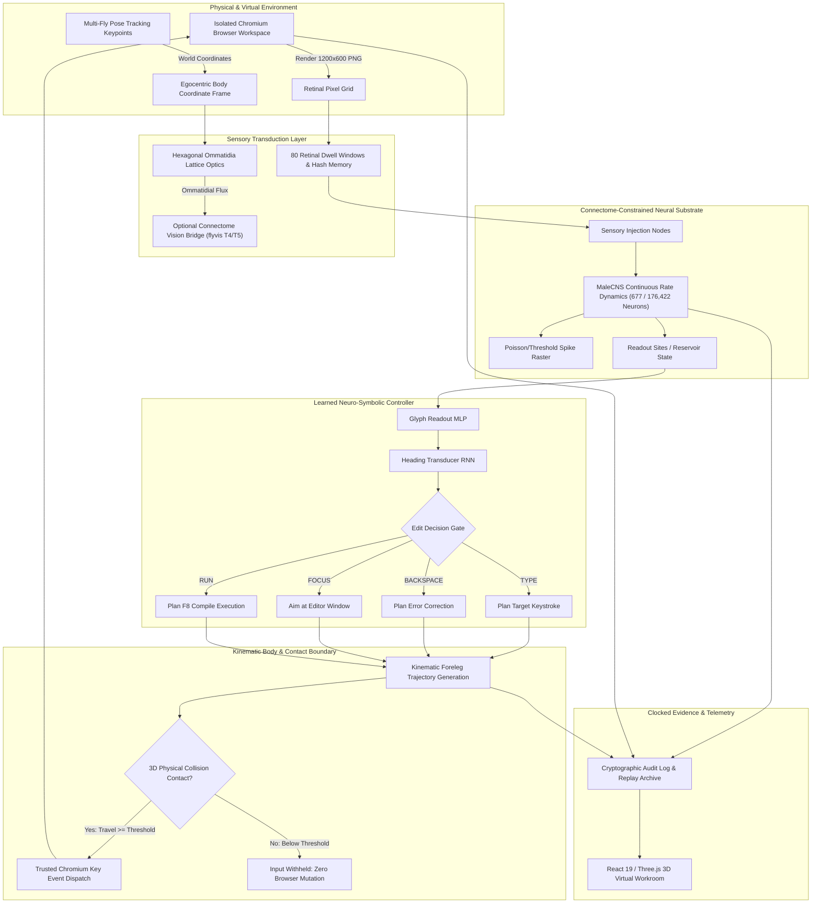
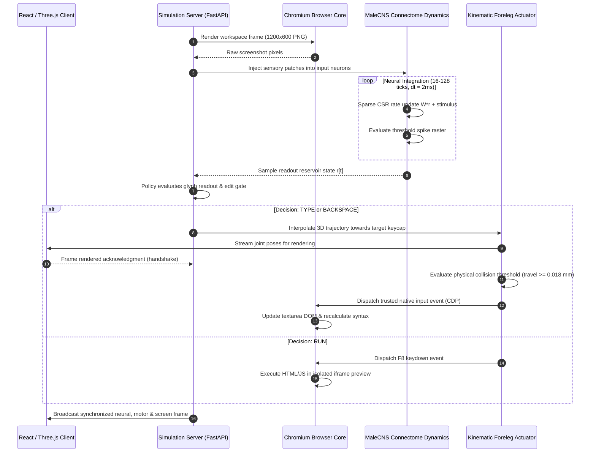
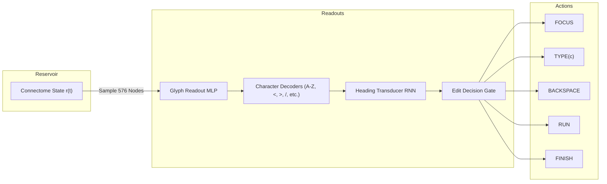

# End-to-End System Architecture: FlyLab & PERCEPT-Fly
**A Deep Neuro-Symbolic and Connectome-Constrained Embodied AI Framework**

---

## Abstract

Modern foundation models operate on ungrounded symbolic tokens via programmatic tool-calling or DOM-tree manipulation. **FlyLab** and its complementary sensory module **PERCEPT-Fly (EgoFlyNet)** present an alternative paradigm: **embodied, contact-gated neuro-symbolic interaction**. 

Rather than querying internal data structures, the agent is constrained by a biological sensory-motor bottleneck:
1. It perceives its environment exclusively through rendered optical projections (1200×600 RGB screenshots or compound eye hexagonal ommatidia lattices).
2. It processes visual stimuli through a recurrent *Drosophila* connectome rate-dynamics model (Janelia MaleCNS v1.0).
3. It emits actions via continuous kinematic foreleg motion that must physically collide with rendered keycaps in 3D Euclidean space to authorize native OS-level keyboard events.



---

## 1. The Closed-Loop Physical Sensory-Motor Cycle

The simulation operates on a discrete canonical clock ($dt = 2\text{ ms}$, $500\text{ Hz}$). Sensory input, neural rate integration, motor displacement, and browser DOM evaluation are lock-stepped:



### The Hard Trust Boundary
The policy network is subjected to a strict sensory-motor isolation boundary:
* **DOM Blindness:** The policy never queries DOM elements, accessibility trees, ASTs, or tokenized strings.
* **Reward Isolation:** No loss signal, reward metric, or error indicator is passed to the agent during runtime.
* **Input Integrity:** JavaScript `element.value = ...` and synthetic `dispatchEvent` calls are prohibited. Every character requires a physical contact collision event.

---

## 2. Sensory Subsystem: Retinal Transduction & Memory

The visual cortex interface translates the $1200 \times 600$ viewport into localized neural stimulations:

```
┌────────────────────────────────────────────────────────────────────────┐
│                        1200 × 600 Browser Viewport                     │
├──────────────────────┬───────────────────────┬─────────────────────────┤
│    Section 1: TARGET │   Section 2: EDITOR   │   Section 3: PREVIEW    │
│    (400 × 540 px)    │   (400 × 540 px)      │   (400 × 540 px)        │
│                      │                       │                         │
│  [24 Retinal Slots]  │  [24 Retinal Slots]   │  [24 Retinal Slots]     │
│   (24 × 24 px each)  │   (24 × 24 px each)   │   (24 × 24 px each)     │
└──────────────────────┴───────────────────────┴─────────────────────────┘
```

### 2.1 Fixed Retinal Sampling Slots
1. **Target Substrate:** 24 horizontal retinal slots positioned over the target specification heading.
2. **Editor Substrate:** 24 retinal slots capturing typed code inside the editor textarea.
3. **Preview Substrate:** 24 retinal slots capturing the live browser execution output.
4. **State Indicators:** 8 dedicated slots monitoring cursor caret focus, execution run state, and compile status.

### 2.2 Saccadic Visual Memory & Differential Refresh
To prevent redundant computation across static frames, each retinal patch $\mathbf{P}_i \in \mathbb{R}^{24 \times 24}$ is hashed:
$$h_i = \text{SHA256}(\mathbf{P}_i)$$
* If $h_i(t) == h_i(t - 1)$, the visual reading is drawn from short-term retinal cache.
* If $h_i(t) \neq h_i(t - 1)$, the new patch is injected into the sensory nodes, advancing simulation by $\Delta t_{\text{saccade}} = 16\text{ ms}$ to allow transient dynamics to settle before decoding.

---

## 3. Neural Substrate: Connectome-Constrained Rate Dynamics

FlyLab embeds the visual policy inside a connectome reconstruction derived from the Janelia **MaleCNS v1.0** dataset:

### 3.1 Anatomical Topologies
* **Full-CNS Network:** 176,422 identified neuron records and 25,862,574 directed synaptic connections.
* **Subgraph Model:** 677 structurally conserved neurons spanning the optical lobes, central complex (protocerebral bridge, ellipsoid body, fan-shaped body), and descending motor pathways.

### 3.2 Continuous Rate Formulation
The recurrent state $\mathbf{r}(t) \in \mathbb{R}^N_{\ge 0}$ evolves according to continuous leaky rate dynamics:
$$\tau \frac{d\mathbf{r}}{dt} = -\mathbf{r}(t) + \operatorname{ReLU}\left(\mathbf{W}_{\text{norm}} \mathbf{r}(t) + \mathbf{W}_{\text{in}} \mathbf{s}(t) + \mathbf{b}\right)$$

Where:
* $\tau = 20\text{ ms}$ is the biological membrane integration time constant.
* $\mathbf{W}_{\text{norm}} = \mathbf{D}^{-1/2} \mathbf{W} \mathbf{D}^{-1/2}$ is the normalized connectome adjacency matrix with strictly positive synapse counts.
* $\mathbf{s}(t) \in \mathbb{R}^{101}$ is the sensory injection vector.
* $\mathbf{b} \in \mathbb{R}^N$ is the baseline resting potential vector.

### 3.3 Threshold Spike Generation
While integration is continuous, binary event streams are extracted via a dynamic threshold model for neuromorphic visualization and instrumentation:
$$S_j(t) = \mathbb{I}\left(r_j(t) - \theta_j(t) > 0\right)$$
$$\theta_j(t + dt) = \theta_j(t) + \frac{dt}{\tau_\theta} (\theta_{\text{rest}} - \theta_j(t)) + \Delta_\theta S_j(t)$$

### 3.4 Numerical Kernels
* **Native C Kernel (`csr_parallel.c`):** Utilizes OpenMP multi-threading with 8-way SIMD FMA (Fused Multiply-Add) vectorization over sparse CSR storage formats.
* **SciPy Fallback:** Vectorized sparse matrix-vector multiplication (`scipy.sparse.csr_matrix`).

---

## 4. Learned Controller & Self-Correction

The high-level policy consists of trained feed-forward readouts from the connectome reservoir:



### Closed-Loop Visual Self-Repair
FlyLab tests visual feedback by intentionally injecting an unannounced physical key substitution fault at step $i = 10$ (e.g., typing `X` instead of `W`). 
Because the policy relies strictly on rendered pixels:
1. The erroneous glyph appears in the Chromium screenshot at step $i = 11$.
2. The retinal slots over the editor observe a mismatch with the target heading specification.
3. The edit gate emits `BACKSPACE` decisions until the erroneous characters are erased, followed by the correct stroke.

---

## 5. PERCEPT-Fly (EgoFlyNet) Visual Reconstruction Subsystem

While FlyLab models interaction with digital interfaces, **PERCEPT-Fly (EgoFlyNet)** provides an egocentric sensory model for behavioral tracking and visual neuroscience experiments.

### 5.1 Kinematic Body Reference Frame
Given tracked 3D coordinates for head $\mathbf{p}_{\text{head}}$ and thorax $\mathbf{p}_{\text{thorax}}$:

1. **Forward Axis:**
   $$\mathbf{u}_{\text{fwd}} = \frac{\mathbf{p}_{\text{head}} - \mathbf{p}_{\text{thorax}}}{\|\mathbf{p}_{\text{head}} - \mathbf{p}_{\text{thorax}}\|}$$
2. **Right Axis:**
   $$\mathbf{u}_{\text{right}} = \frac{\mathbf{u}_{\text{world\_up}} \times \mathbf{u}_{\text{fwd}}}{\|\mathbf{u}_{\text{world\_up}} \times \mathbf{u}_{\text{fwd}}\|}$$
3. **Dorsal Axis:**
   $$\mathbf{u}_{\text{up}} = \mathbf{u}_{\text{fwd}} \times \mathbf{u}_{\text{right}}$$

The rotation matrix $\mathbf{R} = [\mathbf{u}_{\text{fwd}} \;\; \mathbf{u}_{\text{right}} \;\; \mathbf{u}_{\text{up}}]$ maps any external point $\mathbf{p}_w$ into egocentric coordinates:
$$\mathbf{p}_{\text{ego}} = \mathbf{R}^T (\mathbf{p}_w - \mathbf{p}_{\text{head}})$$

### 5.2 Hexagonal Compound Eye Lattice
The compound eye is parameterized into $N \approx 720$ discrete ommatidia arranged on alternating hexagonal rows:

$$\phi_{jk} = \phi_{\text{start}} + k \cdot \Delta\phi + (j \bmod 2) \frac{\Delta\phi}{2}$$

Each ommatidial optical axis $\mathbf{a}_m$ is defined on the unit sphere:
$$\mathbf{a}_m = \begin{bmatrix} \cos\theta_m \cos\phi_m \\ \cos\theta_m \sin\phi_m \\ \sin\theta_m \end{bmatrix}$$

```
                Left Eye (Azimuth < 0)         Right Eye (Azimuth > 0)
Elevation (+)        ·   ·   ·   ·   ·                 ·   ·   ·   ·   ·
                      ·   ·   ·   ·   ·                 ·   ·   ·   ·   ·
Elevation (0)   ·   ·   ·   ·   ·   · [Overlap] ·   ·   ·   ·   ·   ·   ·
                      ·   ·   ·   ·   ·                 ·   ·   ·   ·   ·
Elevation (-)        ·   ·   ·   ·   ·                 ·   ·   ·   ·   ·
               -160°            -20°   0°   +20°            +160°
```

### 5.3 Geometric Optics & Receptive Fields
For every partner limb element $i$ at position $\mathbf{p}_{\text{ego}, i}$, distance $d_i = \|\mathbf{p}_{\text{ego}, i}\|$ and unit line-of-sight $\mathbf{u}_i = \mathbf{p}_{\text{ego}, i} / d_i$:
1. **Angular Divergence:** $\alpha_{im} = \arccos(\operatorname{clip}(\mathbf{a}_m \cdot \mathbf{u}_i, -1, 1))$
2. **Gaussian Acceptance Profile:** $W_{im} = \exp\left(-\frac{\alpha_{im}^2}{2\sigma^2}\right)$, with $\sigma \approx 5.0^\circ$.
3. **Solid-Angle Inverse-Square Falloff:**
   $$I_m(t) = \sum_{i} \frac{W_{im}(t)}{\max(d_i(t), d_{\min})^2}$$

### 5.4 Connectome Vision Bridge (`flyvis`)
The resulting spatiotemporal array $\mathbf{I} \in \mathbb{R}^{T \times N}$ can optionally pass to the pretrained `flyvis` connectome network (Lappalainen et al., Nature 2024), yielding population activity traces for motion-sensitive neural subtypes:
* **T4 Cells (Medulla $\to$ Lobula Plate):** Four directional subtypes (T4a, T4b, T4c, T4d) sensitive to front-to-back, back-to-front, upward, and downward ON-motion.
* **T5 Cells (Lobula $\to$ Lobula Plate):** Equivalent directional selectivity for OFF-contrast edges.

---

## 6. End-to-End Scientific Architecture Comparison

| Dimension | FlyLab Physical Coding | PERCEPT-Fly (EgoFlyNet) |
|---|---|---|
| **Primary Domain** | Contact-gated physical coding & tool-use | Multi-fly behavioral tracking & egocentric vision |
| **Input Modality** | Rendered 1200×600 Chromium browser PNG | Tracked 3D pose keypoints (SLEAP / DeepLabCut) |
| **Visual Geometry** | 80 Planar Retinal Sampling Windows | 720 Hexagonal Compound Eye Ommatidia Lattice |
| **Neural Substrate** | Full MaleCNS (176k) / Subgraph (677) rate model | Optional `flyvis` Lobula Plate Motion Model (T4/T5) |
| **Actuation** | Kinematic foreleg with contact collision detection | Kinematic focal-fly body frame (orthonormal basis) |
| **Downstream Mutation**| Native Chromium OS-level keyboard events | Visual excitation tracks & neural motion traces |
| **Trust Model** | DOM-blind, AST-blind, reward-blind | Calibration-blind, point-mass geometric projection |

---

## 7. Limitations and Epistemic Honesty Disclosures

1. **Dynamics Are Modeled, Not Reconstructed Electrophysiology:**
   The neural substrate uses normalized, non-negative continuous rate equations. It does not model individual ion channels, dendritic conductance compartmentalization, or biophysical neurotransmitter dynamics.
2. **Simplified Biomechanics:**
   Fly foreleg motion is governed by continuous forward-kinematic point-attractors rather than a full multi-segment musculo-skeletal physics engine.
3. **Curriculum Scope:**
   The neural controller is trained specifically on single-line HTML heading synthesis (`<h1>...</h1>`). It is an experimental demonstration of grounded physical keyboard contact, **not** an artificial general intelligence or a general coding agent.
